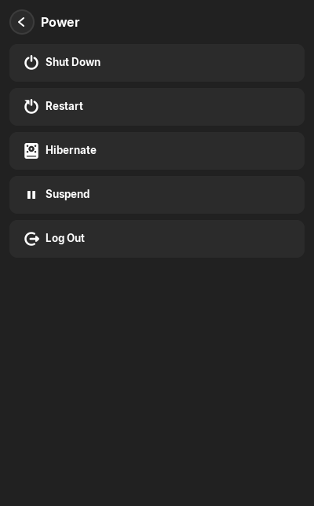

# Quick Settings — Plugin para o Painel XFCE

Popup com controles de áudio, brilho, rede, energia, sessão e sistema.


## Telas

Tela principal com sliders de volume e brilho, tiles de acesso rápido,
cartão de bateria, mini-tiles e versão.


### Áudio

Buses de saída/entrada com sliders de volume por aplicativo.


### Night Light

Temperatura da tela com 5 presets (inclui temperatura atual do sensor).


### Monitor

Linhas de monitor, modo e escala (persistida por saída).


### Wi-Fi

> Capturada numa VM sem adaptador Wi-Fi (só ethernet); com adaptador,
> a página lista as redes disponíveis.


### Bluetooth

> Capturada numa VM sem adaptador Bluetooth; com adaptador, a página
> lista os dispositivos pareados e próximos.


### Sistema

Uso de CPU/memória com gráfico e lista de processos.


### Notificações

Central de notificações (vazia nesta captura).


### Energia e sessão

Cartão de bateria (nível, estado e estimativa) e botões de sessão
(suspender, reiniciar, desligar, …).



## Instalar no Arch

```sh
sh install/arch/install.sh
```

## Instalar no Debian/Ubuntu

```sh
sh install/debian/install.sh
```

> Lógica comum em install/common/; install/common/desktop.sh gera o .desktop em script (heredoc) e o instala; install/arch/* e install/debian/* são wrappers finos (só deps.sh difere por distro).

## Usar

Botão direito no painel → Adicionar Novos Itens → "Quick Settings".

## Pré-requisitos

- Compiladores: `gcc`, `make`, `pkg-config`
- Dev GTK/XFCE: `gtk3`, `xfce4-panel`, `libxfce4ui`, `sqlite`
- Ferramentas: `brightnessctl`, `upower`, `nmcli`, `bluetoothctl`, `pactl`, `xrandr`
- Painel XFCE em execução (`xfce4-panel`)
- Permissão sudo para instalar o plugin e a regra de backlight

## Desinstalar

```sh
sh install/arch/uninstall.sh
```

```sh
sh install/debian/uninstall.sh
```
