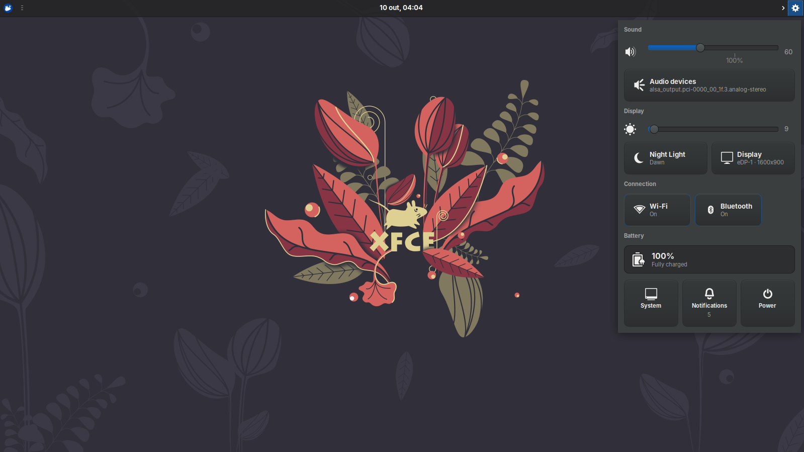

# Quick Settings — Plugin para o Painel XFCE

Plugin de configurações rápidas para o XFCE Panel, escrito em C com GTK3.
Exibe um popup com controles de áudio, brilho, rede, energia, sessão e sistema.

## Captura de tela



## Funcionalidades

- Áudio: controle de volume e mudo.
- Brilho / Display: ajuste de brilho e configurações de monitor.
- Rede: Wi-Fi, Bluetooth e estado da conexão.
- Energia: perfil e status da bateria.
- Sessão: suspender, reiniciar, desligar e sair.
- Notificações: alternar avisos do sistema.
- Sysmon: visão rápida de CPU, memória e disco.
- Night Light: filtro de luz noturna.
- Popup e tema: janela popup com tema GTK integrado.

## Requisitos

- `gcc`
- `pkg-config`
- `gtk+-3.0`
- `libxfce4panel-2.0`
- `libxfce4ui-2`
- `libxfce4util-1.0`
- `sqlite3`

No Debian/Ubuntu, instale com:

```sh
sudo apt install gcc pkg-config libgtk-3-dev libxfce4panel-2.0-dev libxfce4ui-2-dev libxfce4util-dev libsqlite3-dev
```

## Compilação

```sh
make
```

## Instalação

Via Makefile (instala no diretório do plugin obtido por `pkg-config libxfce4panel-2.0`):

```sh
sudo make install
```

Ou via script:

```sh
sh install.sh
```

Depois, adicione o plugin "Quick Settings" ao painel do XFCE
(botão direito no painel → Adicionar Novos Itens).

## Desinstalação

```sh
sudo make uninstall
```

Ou:

```sh
sh uninstall.sh
```

## Uso básico

1. Compile e instale conforme acima.
2. Adicione "Quick Settings" ao painel do XFCE.
3. Clique no ícone do painel para abrir o popup.
4. Ajuste volume, brilho, Wi-Fi, Bluetooth, energia e notificações pelo popup.

## Estrutura do repositório

- `Makefile` — compilação, instalação e desinstalação.
- `src/` — código-fonte em C (`qs-plugin.c`, `qs-core`, `qs-ui`, `qs-util`,
  `qs-audio`, `qs-display`, `qs-brightness`, `qs-monitor`, `qs-nightlight`,
  `qs-net`, `qs-wifi`, `qs-bluetooth`, `qs-power`, `qs-session`,
  `qs-notify`, `qs-sysmon`, `qs-popup`, `qs-theme` e headers).
- `data/quicksettings.desktop` — descritor do plugin (X-XFCE-PanelPlugin, API 2.0).
- `install.sh` / `uninstall.sh` — scripts de instalação e remoção.

## Licença

Não há arquivo LICENSE definido neste repositório.
