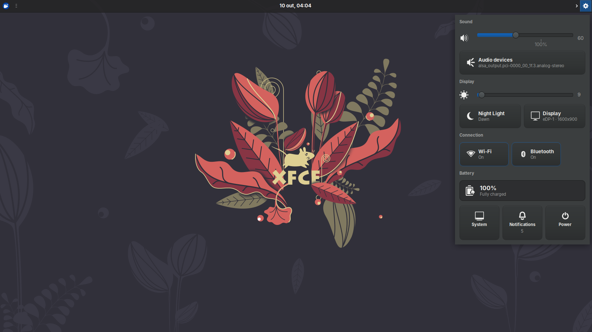
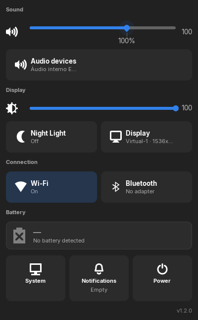
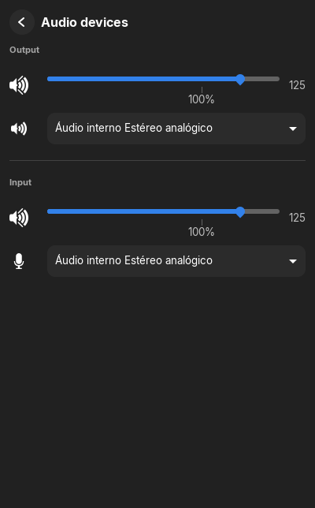
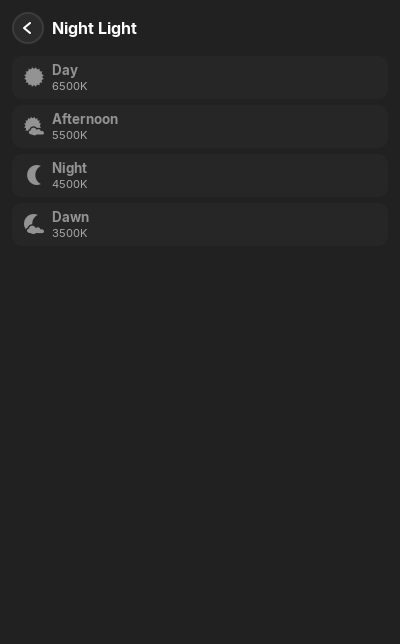
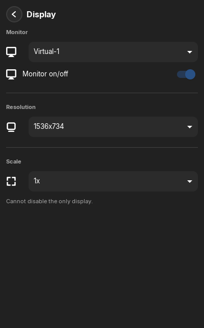
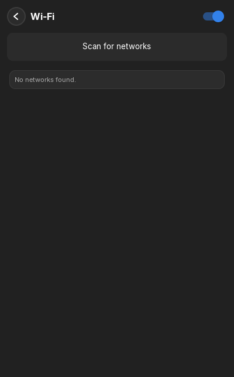
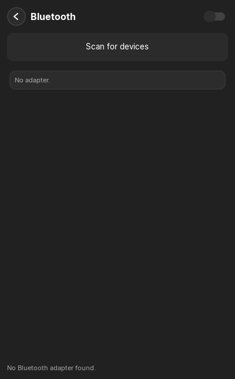
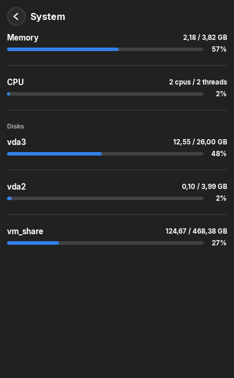
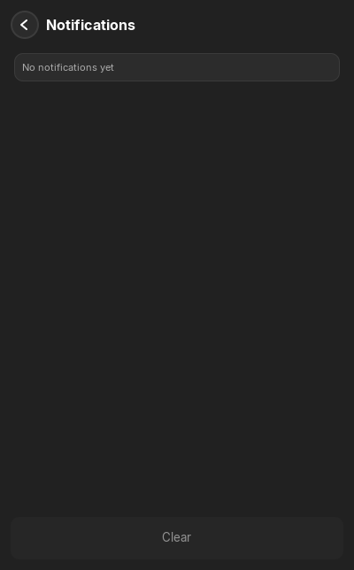

# Quick Settings for the Xfce panel

Quick Settings is a panel plugin for Xfce that puts the everyday controls in one place: volume and brightness, Wi-Fi and Bluetooth, night light and display settings, audio devices, battery, notifications, system stats, and power options. Most of these are quick changes, and keeping them together saves a trip through separate settings windows.

Click the panel icon and the popup opens under it. Click anywhere else or press Esc and it goes away. The popup shows the last known state first and refreshes in the background, so opening it doesn't wait on NetworkManager or BlueZ.

It's a GTK3 plugin written in C, and it follows your GTK theme, so it fits light and dark setups. There's no extra daemon: it uses `nmcli`, `bluetoothctl`, `pactl` or `wpctl`, `brightnessctl`, `xrandr`, and UPower, the tools already on most Xfce systems.



## What's in the popup

The Wi-Fi and Bluetooth screenshots below come from a VM without those adapters, so their lists are empty. On a laptop or desktop with the hardware, they show nearby networks and devices.

### Main page



The first page has a volume slider and a brightness slider, plus tiles for Wi-Fi, Bluetooth, night light, display, and audio devices. A battery card sits below them. The three small tiles at the bottom open System, Notifications, and Power.

### Audio devices



The Audio devices page gives you separate output and input sliders and a picker for each device. The sliders go up to 150%, which is useful when a track is just too quiet. That boost works with PulseAudio and PipeWire; the `amixer` fallback stops at 100%.

### Night light



Night Light has four presets with fixed temperatures: Day (6500K), Afternoon (5500K), Night (4500K), and Dawn (3500K). Click one to apply it, then click it again to turn it off. The presets call `redshift` or `gammastep`, so one of those has to be installed.

### Display



Pick the monitor you want to change, turn it off or back on, then choose a resolution and a scale. The scale is saved per output and restored when you open the page again.

### Wi-Fi



Use the switch to turn Wi-Fi on or off, scan, and click a network to connect. A password prompt appears for networks you haven't saved. The tile on the main page shows the SSID you're connected to.

### Bluetooth



Use the switch to turn Bluetooth on or off, scan, and click a device to connect. On a new device the plugin pairs, trusts, and connects it in that order; clicking a connected device disconnects it. Right-click a row to trust or rename the device.

### System



CPU and memory update every two seconds while the page is open. Below them are the disks and swap, with used and total space; partitions smaller than 1 GB are left out.

### Notifications



The tile shows how many notifications `xfce4-notifyd` has saved. Open it to read the history, click a notification to expand it, and click Clear to delete the history.

### Power


The battery card shows the charge level, whether it's charging or discharging, and the time to empty or full when UPower reports it. The Power page has Shut Down, Restart, Hibernate, Suspend, and Log Out.

## Install

The repository includes a prebuilt x86_64 plugin at `release/x86_64-linux/libquicksettings.so`. The install scripts copy it into the panel plugin directory, add the panel entry, set up the backlight udev rule, add you to the `video` group, and reload the panel. They don't compile anything.

### Requirements

- Xfce with a running panel and GTK3.
- `gcc`, `make`, `pkg-config`, and the development packages for GTK3, libxfce4panel 2.0, libxfce4ui 2, libxfce4util 1, and SQLite.
- `brightnessctl`, UPower, NetworkManager, BlueZ, PulseAudio or PipeWire utilities, and `xrandr` for the pages that use them.
- `redshift` or `gammastep` for Night Light, and `xfce4-notifyd` for the notification history.
- sudo for the system files and the udev rule.

The Arch and Debian scripts install the build packages and the helpers for networking, Bluetooth, audio, brightness, battery, and display. They leave Night Light and notification history to you.

### Arch and Debian/Ubuntu

Clone the repo:

```sh
git clone https://github.com/densyy/xfce-quick-settings.git
cd xfce-quick-settings
```

On Arch:

```sh
sh install/arch/install.sh
```

On Debian or Ubuntu:

```sh
sh install/debian/install.sh
```

If you're on another distribution, install the same packages with your package manager, run `make build`, then run `sh install/common/desktop.sh`.

On a non-x86_64 machine, install the dependencies first, then `make build`, then install. On Arch or Debian/Ubuntu, the deps script does the first step (`sh install/arch/deps.sh` or `sh install/debian/deps.sh`). The same applies after you change the source: rebuild before installing. The shipped binary is x86_64 only.

### Add it to the panel

Right-click the panel, choose Panel > Add New Items..., and pick Quick Settings. If it doesn't show up, reload the panel with `xfce4-panel -r`.

If the brightness slider can't reach the backlight after installing, log out and back in. The `video` group change only applies to a new session.

## Uninstall

On Arch:

```sh
sh install/arch/uninstall.sh
```

On Debian or Ubuntu:

```sh
sh install/debian/uninstall.sh
```

This removes the plugin, the panel entry, and the udev rule. Packages that were installed as dependencies are left alone.

## Good to know

- Wi-Fi goes through NetworkManager. If `nmcli` can't manage the connection, the page can't do much.
- Bluetooth needs BlueZ, `bluetoothctl`, and an adapter that BlueZ can see.
- Notification history is read from `xfce4-notifyd`'s database. Another notification daemon keeps its history elsewhere, so the page stays empty.
- Night Light calls `redshift` or `gammastep`. Neither is pulled in by the install scripts.
- Audio uses `pactl`, then `wpctl`, then `amixer`. The 150% boost only applies to the first two; `amixer` is capped at 100%.
- There's no per-app volume mixer, and the System page has no process list. It shows CPU, memory, disks, and swap.
